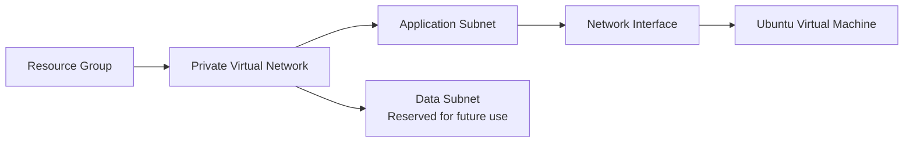

# Architecture overview

## What it deploys

This template creates a small, isolated Azure environment for hosting a Linux-based application or training workload.

## Major components

- **Resource group**  
  A single container that keeps all deployed resources together for easier management, reporting, and cleanup.

- **Private virtual network**  
  An isolated network where the solution's resources can communicate securely.

- **Application subnet**  
  A dedicated section of the network for application servers. The virtual machine is placed here.

- **Data subnet**  
  A separate network section reserved for future databases or other data services. The template does not currently deploy anything into it.

- **Network interface**  
  Connects the virtual machine to the application subnet. It receives a private network address automatically.

- **Linux virtual machine**  
  An Ubuntu 22.04 server using the cost-conscious `Standard_B2s` size. It uses an SSH key instead of a password for administrator access.

## How the components relate

The network must be created before the virtual machine because the server depends on its network interface.

## Business considerations

- Everything is deployed to **East US** by default.
- Resources are tagged as a **Training** environment for ownership and cost tracking.
- The server has **no public internet address**, so it cannot be accessed directly from the internet.
- No database, load balancer, backup service, monitoring, or explicit network firewall rules are deployed.
- The template reports whether the server was created successfully and returns references to the main resources.

## Parameter reference

| Parameter Name | Type | Default Value | Allowed Values | Description |
|---|---|---|---|---|
| `location` | `string` | `eastus` | Not restricted | Azure region for all resources. |
| `resourceGroupName` | `string` | `rg-agentic-iaclab` | Any non-empty string | Name of the resource group to create. |
| `vnetName` | `string` | `vnet-agentic-iaclab` | Any non-empty string | Name of the virtual network. |
| `vnetAddressPrefix` | `string` | `10.10.0.0/16` | Not restricted | Virtual network address space. |
| `appSubnetName` | `string` | `snet-app` | Any non-empty string | Name of the application subnet. |
| `appSubnetAddressPrefix` | `string` | `10.10.1.0/24` | Not restricted | Application subnet address prefix. |
| `dataSubnetName` | `string` | `snet-data` | Any non-empty string | Name of the data subnet. |
| `dataSubnetAddressPrefix` | `string` | `10.10.2.0/24` | Not restricted | Data subnet address prefix. |
| `nicName` | `string` | `nic-vm-iaclab` | Any non-empty string | Name of the virtual machine network interface. |
| `vmName` | `string` | `vm-iaclab` | Any non-empty string | Name of the virtual machine. |
| `vmSize` | `string` | `Standard_B2s` | Not restricted | Virtual machine size. |
| `vmImagePublisher` | `string` | `Canonical` | Not restricted | Publisher of the virtual machine image. |
| `vmImageOffer` | `string` | `0001-com-ubuntu-server-jammy` | Not restricted | Offer of the virtual machine image. |
| `vmImageSku` | `string` | `22_04-lts-gen2` | Not restricted | SKU of the virtual machine image. |
| `vmImageVersion` | `string` | `latest` | Not restricted | Version of the virtual machine image. |
| `vmAdminUsername` | `string` | `azureuser` | Any non-empty string | Virtual machine administrator username. |
| `sshPublicKey` | Secure `string` | None; required | Not restricted | SSH public key used to authenticate to the virtual machine. Its value is treated as sensitive. |
| `tags` | `object` | `{ Environment: 'Training', Owner: 'agentic-iaclab' }` | Not restricted | Tags applied to all resources that support tags. |

The template does not declare fixed value lists with the Bicep `@allowed` decorator. Azure may still reject values that are unsupported by a resource, region, naming rule, or network configuration.

## Output reference

| Output Name | Type | Value | Description |
|---|---|---|---|
| `resourceGroupId` | `string` | Resource group resource ID | Identifies the resource group created by the deployment. |
| `vnetId` | `string` | Virtual network resource ID | Identifies the deployed virtual network. |
| `nicId` | `string` | Network interface resource ID | Identifies the network interface connected to the virtual machine. |
| `vmId` | `string` | Virtual machine resource ID | Identifies the deployed virtual machine. |
| `vmProvisioningState` | `string` | Virtual machine provisioning state | Reports the virtual machine's deployment status. |

## Source templates

- [Main deployment template](../agentic-iac-lab-files/lab-files/templates/main.bicep)
- [Network module](../agentic-iac-lab-files/lab-files/templates/modules/network.bicep)
- [Virtual machine module](../agentic-iac-lab-files/lab-files/templates/modules/virtual-machine.bicep)
